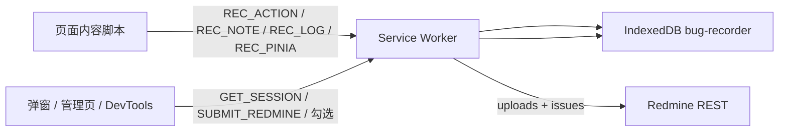

# Bug Recorder for Redmine 设计文档

版本：0.2.4  
配套：[需求文档](需求文档.md)、[设计问题](设计问题.md)

## 1. 运行时

插件是 MV3 扩展。页面里的内容脚本只负责采集，service worker 负责落库、截图和访问 Redmine，管理页 / DevTools 只负责查看和提交。

三条内容脚本都匹配 `http://*/*` 与 `https://*/*`，且 `all_frames: true`：

| 脚本 | 世界 | 时机 | 职责 |
| --- | --- | --- | --- |
| `content/console-hook.ts` | MAIN | `document_start` | 包住 console，把日志交给后台 |
| `content/vue-probe.ts` | MAIN | `document_start` | 读 Vue 组件 / Pinia。主世界才能碰到页面里的 Vue |
| `content/recorder.ts` | 隔离世界 | `document_idle` | 监听点击、输入、提交，通过自定义事件向主世界要 Vue 信息 |

隔离世界读不到主世界的对象，所以探针结果经 `bugrec:probe` / `bugrec:vue-info` 和 `window` 上的桥交接（`content/bridge.ts`）。探针失败时步骤照记，`vue` 为空。

## 2. 模块

源码按目录分界，构建时每个入口打成单文件，共享模块被内联进那个入口。

| 目录 | 职责 |
| --- | --- |
| `shared/types.ts` | 会话、步骤、消息表 |
| `shared/describe.ts` | 步骤文案、时间、截断、issue 标题 |
| `shared/timeline.ts` | 大步骤、搜索、捕获类别过滤、props diff、勾选归属 |
| `shared/report.ts` | Markdown 描述。顺序固定为正序 |
| `shared/shots.ts` | 截图上传计划。管理页命名和后台上传共用 |
| `shared/capture.ts` | 捕获开关的归一化和「这条请求记不记」 |
| `shared/redmine.ts` | 地址整理与 REST 客户端 |
| `shared/db.ts` | IndexedDB。库版本 3，六张表都有 `bySession` |
| `background/recorder.ts` | 开始/停止、导航步骤、380ms 截图 |
| `background/net-capture.ts` | `webRequest` 元数据 |
| `background/net-cdp.ts` | `chrome.debugger` 响应体与 Console。仅 Chrome |
| `background/redmine-submit.ts` | 组附件、创建或更新 issue |
| `background/router.ts` | 消息分发。监听器在 worker 顶层同步注册 |
| `manager/` | 提交页。`range.ts` 裁剪范围，`export-csv.ts` 生成 CSV |
| `devtools/` | 会话列表、时间轴、大步骤勾选、选区 |
| `popup/` | 开始/停止和打开管理页 |

`background/service-worker.ts` 只做注册：网络、录制、批注、路由，然后异步恢复状态。MV3 休眠后靠顶层监听器被再次唤醒。

## 3. 数据

IndexedDB 库名 `bug-recorder`，版本 3。

| 表 | 主键 | 内容 |
| --- | --- | --- |
| `sessions` | `id` | 起止时间、状态 `recording \| stopped \| submitted`、历次 `submissions` |
| `actions` | 自增 `id` | 步骤。含选择器、值、Vue、坐标、截图 data URL、`tabId` |
| `requests` | 自增 | 方法、URL、状态、耗时、可选正文 |
| `logs` | 自增 | Console |
| `pinia` | 自增 | store、变更字段或 action 参数 |
| `notes` | 自增 | 修改意见 |

设置（Redmine 地址、API Key、捕获开关、上次选的项目）在 `storage.local`。勾选集合和一次性提交选区在 `storage.session`，session 不可用时选区落到 `storage.local`。

消息名集中在 `ResultMap`：内容脚本用 `REC_*`，界面用 `START_RECORDING`、`GET_SESSION`、`SUBMIT_REDMINE` 等。新增消息时同时改类型和 `background/router.ts`。

## 4. 录制链路

1. `startRecording` 生成会话 id，写入 `sessions`，徽章改为录制中。
2. 若当前标签是 http(s)，先记一条 navigate，并在 Chrome 上尝试挂 debugger。
3. 内容脚本把步骤发给 `REC_ACTION`。未在录制中则直接丢弃。
4. 后台给步骤补上 `sessionId`、`tabId`，写入 `actions`，约 380ms 后 `captureVisibleTab`。标签已不是可见页则放弃这张图。
5. `chrome.tabs.onUpdated` 看到地址变化时再记 navigate。`pageUrl` 去掉 hash 后若与该标签上一页相同，则不记。
6. 停止时把状态改为 `stopped`，卸下 debugger，清掉未完成的请求缓存。

键盘输入在内容脚本里按元素防抖 700ms。回车和 Esc 会先冲掉防抖再记 `keypress`。

Pinia 事件单会话最多 500 条，超出后不再写入。

## 5. 时间线

`buildPages` 是管理页、DevTools、描述、CSV 的共同分组规则。

1. 按步骤数组顺序扫描。地址（`pageUrl`）变化就新开一个大步骤。
2. `kind === 'navigate'` 且地址没变：这条跳转不进入大步骤。
3. 一条步骤都没有时，造一个伪页面 `(未记录页面)`，用来装录制开始前的请求和事件。伪页面没有任何条目则丢掉。
4. 每个大步骤的时间窗是 `[本页 startTs, 下一页 startTs)`。请求和事件按 `ts` 落入窗口。早于第一页的事件归到第一页，描述里用 `ownerStepIdx < 0` 表示「步骤开始前」。
5. 页内再按时间排。时间相同用固定次序：action、note、pinia、log、request。
6. 非步骤事件的 `ownerStepIdx` 是「不晚于它的最后一条步骤」。勾选过滤用同一规则（`ownedBySelection`）。

界面上的倒序、搜索、捕获类别过滤只影响显示。`buildDescription` 自己再调一次 `buildPages`，始终正序，并且不吃搜索词。

截图计划 `planShotUploads`：

- 只保留有 `screenshot` 的步骤
- `shotLimit > 0` 时取数组末尾 N 张
- 同时有 `point` 和 `viewport` 的文件用 `step-NN.png`，其余 `step-NN.jpg`
- 序号从 1 连续编，不受原始步骤 id 影响

描述里的文件名来自这份计划，所以上传件和正文里的 `step-NN` 对齐。

## 6. 提交

`submitRedmine` 的输入来自管理页已经 review 过的标题、正文、项目和勾选 id。

1. 有 `selectedActionIds` 时只留这些步骤。请求、日志、Pinia、意见按 `ownedBySelection` 跟着步骤走。
2. 截图：按计划逐张上传。PNG 路径先用 OffscreenCanvas 把点击圈画进像素；环境没有 OffscreenCanvas 或绘制失败时，改发原始 JPEG 字节。
3. CSV：`buildCsv` 的正文前加 UTF-8 BOM。文件名 `bug-recorder-session-{id前8位}.csv`。
4. `issueId` 为空则创建，否则更新。更新成功后 Redmine 常返回 204，本地仍沿用原 id。
5. `appendSubmission` 按 issue id 合并历史。同一条 issue 再次提交只增加 `revisionCount`，不再追加一行链接。

REST 客户端的容错集中在 `shared/redmine.ts`：

- `normalizeBase` 去掉 hash、查询串和页面路径，最多剥三层。`/issues/8` 可以剥掉，`/issues/8.json` 目前剥不掉（见设计问题 DQ-15）
- GET 遇到 401：保留头，再带 `?key=`
- GET 遇到 404：去掉 `X-Redmine-API-Key`，改带 `?key=`。用来应付把自定义头直接挡掉的网关
- POST 不走 404 改写。附件是「`.json` 路径 404 再试无后缀」这一条专用分支
- 日志和抛给界面的错误经 `safeUrl` 删掉 `key` 查询参数

项目列表先分页 `GET /projects.json`，再试不带分页参数，最后才读 `users/current.json?include=memberships`。三处都没有时，错误说明指向「地址不是站点根」，而不是「接口版本不对」。

## 7. 构建与两种浏览器

`build.mjs` 用 esbuild 产出 `dist/`。`tsc --noEmit` 负责类型，esbuild 不负责类型。

`manifest.json` 给 Chrome。`background.service_worker` 与 `background.scripts` 双写，是为了同一份后台入口在两种浏览器都能被找到。Firefox 发布包在打包时换上 `manifest.firefox.json`：去掉 debugger 权限，并固定 gecko id `bug-recorder@x007007007`。

Chrome 扩展 ID 由 manifest 里的 `key` 固定为 `bkeogdmbgodhopooimgmbacldmdmpeap`。两处 ID 都不要随版本改。

## 8. 测试分层

| 层 | 命令 | 覆盖 |
| --- | --- | --- |
| 类型 | `npm run typecheck` | 扩展源码与 `tests/` |
| 单元 | `npm test` | 文案、时间线、范围、描述、CSV、捕获过滤、Redmine 地址与 HTTP 回退、序列化 |
| 冒烟 | `npm run smoke` | 加载 `dist/`，连演示页和假 Redmine 走一遍界面 |

单元测试用 esbuild 把 `tests/*.test.ts` 打成单文件再交给 `node --test`，因此源码里的无扩展名导入不用改成 Node 原生可解析的路径。测试不碰 IndexedDB，也不启动浏览器。
